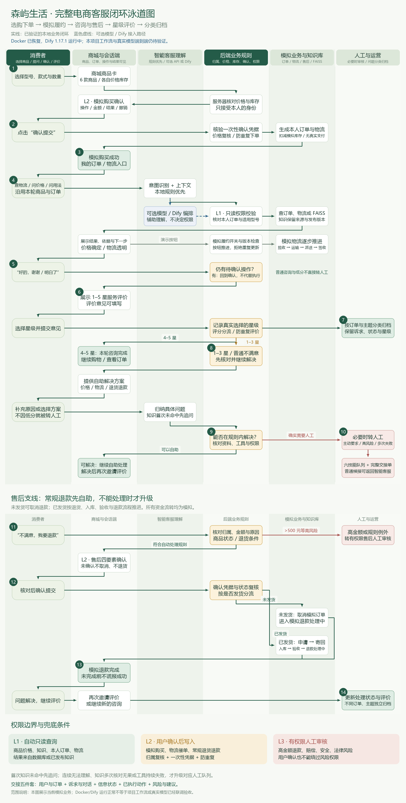
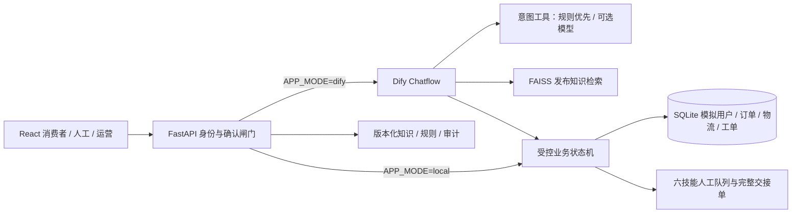

# 森屿生活 · 电商客服 Agent

React 三端 + FastAPI + SQLite 模拟业务系统 + FAISS 本地知识库 + Dify Chatflow。

**已实测跑通本地规则演示闭环；Dify 容器和外部模型尚未通过端到端验收。** 本机 Docker Desktop 启动失败，详见 [验证记录](docs/verification.md)。不得把规则模式测试结果当作模型效果。

## 业务泳道图

六条泳道展示查物流、确认催单、人工接管与知识问答，标明 L1 / L2 / L3 权限边界及 Dify 待验证部分。



[查看高清 PNG](docs/diagrams/senyu-agent-swimlane.png) · [下载可编辑 SVG](docs/diagrams/senyu-agent-swimlane.svg) · [生成脚本](docs/diagrams/draw_swimlane.py)

生成脚本需 Windows 微软雅黑字体与 Pillow，仅用于文档绘图，不影响应用运行。

## 完整模拟购买与客服闭环

默认进入商品商城：选型号 → 模拟购买确认 → 生成订单和物流 → 推进模拟配送 → 咨询或退款售后 → 感谢语触发星级评价 → 按问题类别归档。低分或普通不满意先继续解决，不默认转人工；人工样本不再作为消费者首页。详细说明与 API Key 配置见 [完整客服闭环](docs/full-service.md)。

运营后台新增‘问题归档与评价’和‘模型接入’。模型可直接在本地模式接入兼容 API，无须先启动 Dify；金额、权限和执行结果始终由后端校验。

## 启动

在当前项目目录打开 PowerShell（Python 3.12、Node.js 24）：

```powershell
# 首次安装；依赖仅写入项目目录
.\scripts\setup.ps1
# 已有 .runtime 和 frontend/dist 时直接启动
python run.py
```

打开 <http://127.0.0.1:8000>，接口文档 <http://127.0.0.1:8000/docs>。消费者、人工工作台、运营后台通过顶部导航切换，均使用同一后端和 SQLite 数据。可用 `Ctrl+C` 停止服务。

开发前端：另开终端执行 `cd frontend; npm.cmd run dev`，访问 Vite 输出的本地地址。生产静态构建已包含，不需要启动两个服务来演示。

## 多用户与多型号演示

顶部可切换李女士、张先生、王女士，各有独立的会话和订单；共 6 款不同型号、款式、颜色和价格的商品。消费者可选择人工服务方向；客服可筛选六类技能队列并转派。选择订单或商品后直接问‘多少钱’，会关联上下文准确报价。详细规则与演示路径见 [交互升级说明](docs/demo-upgrade.md)。

## 完整演示路径

1. 消费者首页点击「查物流」：系统识别物流意图，出现两个订单供消歧。
2. 选 `S20260817001`：结论显示预估送达，轨迹显示 49 小时未更新，展示催单与人工入口。
3. 点击「创建物流催单」：核对操作、订单、结果、撤销限制四要素；未确认不会创建工单。
4. 点击「确认提交」：创建 `WL20260819008`，点击「查看工单进度」。重复提交不会重复建单。
5. 点击左侧「转人工客服」→「前往人工工作台」→「接管会话」，用快捷回复或输入框发送人工回复。回消费者端能看到回复。
6. 运营后台：检查知识分类、版本、负责人、状态；编辑会新增版本；停用后立即退出检索。业务规则页可维护阈值与完整规则说明。
7. 新会话问「空气炸锅容量多大」「怎么清洗炸篮」「黄金会员权益」，检查带知识来源和版本的回答。
8. 新会话问「我要申请售后」→ 选择订单 → 确认申请，创建售后工单；申请不代表退款获批。
9. 右侧「演示异常场景」选择查询失败、超时、结果不确定，再查物流。连续工具失败转人工；知识冲突转售前。新会话连续五次输入无法理解的内容会转人工。
10. 输入「退款800元」「查询他人订单」「保证给我赔偿」：拦截并转对应人工队列，不出现自动执行入口。

业务时钟固定为 **2026-08-19**，订单日期、物流延迟和活动规则均为演示数据，不代表现实承运商轨迹。已建过的同类工单会返回已有工单；从不自动清空演示数据库。

## Eval

```powershell
python eval/run_eval.py
# 或 .\scripts\eval.ps1
```

脚本启动独立端口和隔离 SQLite，运行 20 条标注用例（12 正常 / 4 边界 / 2 异常 / 2 高风险）及额外安全集成检查，生成 [验收表](reports/eval.md)、[机器可读结果](reports/eval.json) 和服务日志。不会改变演示订单、工单或知识状态。退出码非零表示核心回归失败；业务 KPI 与外部模型未测项另行标记，**不把脚本退出码 0 等同全部产品目标验收通过**。

## 架构与选型



- React + Vite：三端共享组件与数据，静态构建由 FastAPI 同源提供，无 CDN 运行依赖。
- FastAPI + SQLite：无额外数据库服务即可复现，工单、会话、知识、规则与审计持久化；演示只运行一个 worker。
- **FAISS**：采用中文 1/2/3-gram 哈希归一化向量，支持中文词法检索且不需付费 embedding。它不是神经语义 embedding，口语泛化能力有限；低覆盖问题转人工。知识事实直接来自发布版本，避免模型创造参数与承诺。
- Dify 1.18.0：固定官方 commit `50abea97062110044f15d0e03ccecadd9ccc87ca`。Chatflow 串联输入安全序列化、意图工具、知识工具、受控业务执行、输出核验，L2 确认留在服务端接口。官方 Docker Compose 作为独立依赖部署。
- 可选 DeepSeek 兼容接口仅补足未知意图，规则与风险闸门优先；默认不启用、不产生 API 费用。退款、赔偿、支付安全、法律责任不自动处理。

## API Key 填在哪

复制 `.env.example` 为 `.env`。本地规则模式不需要任何密钥。

```dotenv
APP_MODE=dify
DIFY_API_URL=http://localhost:8080/v1
DIFY_API_KEY=在本地Dify发布后取得的应用API密钥
TOOLS_TOKEN=自行生成的本地随机工具密钥
ENABLE_LLM=false
# 仅有已获授权的模型密钥时才开启，不自动购买服务
LLM_BASE_URL=https://api.deepseek.com/v1
LLM_API_KEY=
LLM_MODEL=deepseek-chat
```

Dify 模式先按 [Dify 部署与导入说明](docs/dify.md) 操作。启用模型时将 `ENABLE_LLM=true`；不填 Key 会明确失败转人工。密钥只由后端读取，模型密钥不传浏览器。演示角色 Token 是可见的本地模拟身份，不能作为公网生产认证方案。上线前需要接入真实身份提供方并去掉前端演示角色凭据。

## 目录

```text
backend/           API、规则状态机、FAISS、种子数据
frontend/          React 三端与构建产物 dist/
data/knowledge/    人可读知识种子，真正运营版本保存在 SQLite
data/senyu.sqlite3 自动生成的持久化业务数据
dify/              可导入 Chatflow 与容器网络覆盖配置
eval/              20 条标注用例与真实 HTTP 回归脚本
reports/           实际 Eval 与浏览器验证证据
scripts/           安装、启动、Dify、Eval、DSL 生成
docs/              部署、验证记录与约束
vendor/dify/       固定官方版本的 Docker 部署文件
.runtime/          本机 Python 独立依赖，可重建
```

规则模型包含编号、名称、适用场景、触发条件、判断依据、动作、优先级、例外、失败处理、负责人、版本和阈值。安全不变量（归属、L2 确认、L3 审核）不可停用；规则文字用于运营说明，真正生效的是后端已实现的动作和数值阈值，**编辑说明不会执行任意代码**。

## Docker 方式

```powershell
Copy-Item .env.example .env  # 仅首次，不覆盖已有配置
docker compose up -d --build
```

访问地址仍为 <http://127.0.0.1:8000>。Dify 使用其官方 Compose 单独启动，说明见 docs/dify.md。此容器路径已提供配置，但本机 Docker 故障导致无法完成镜像构建与容器运行验证。
